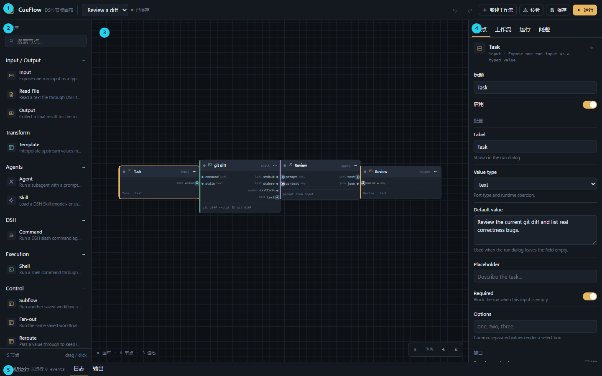
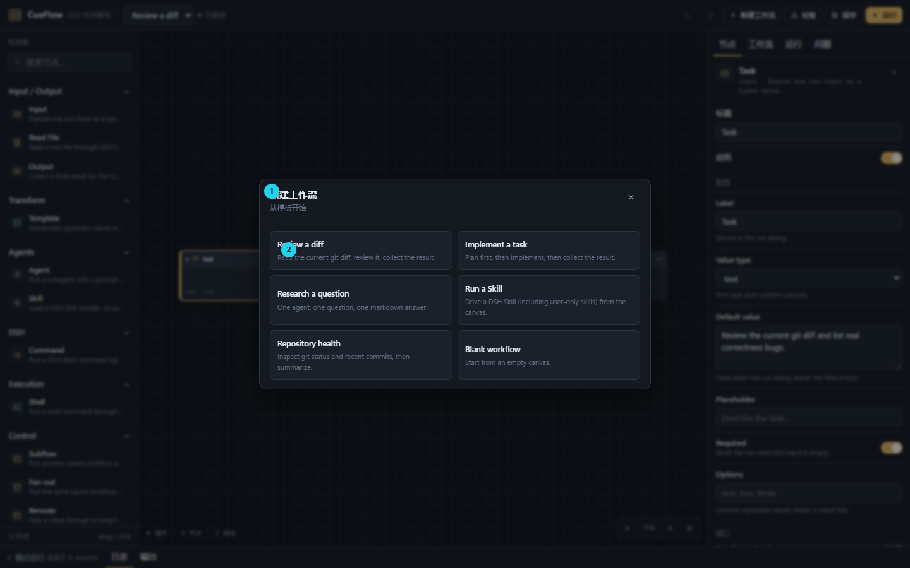
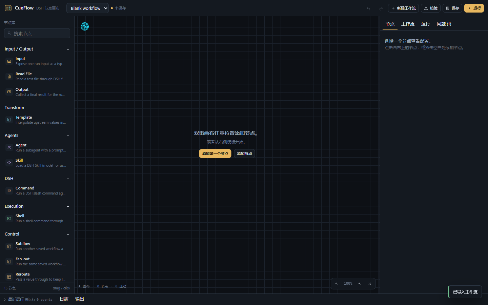
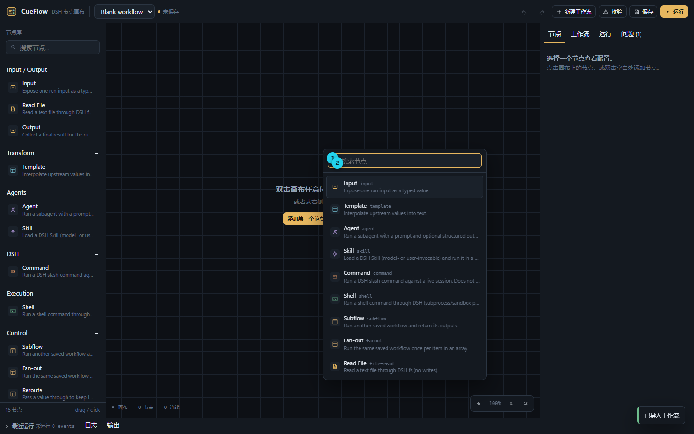
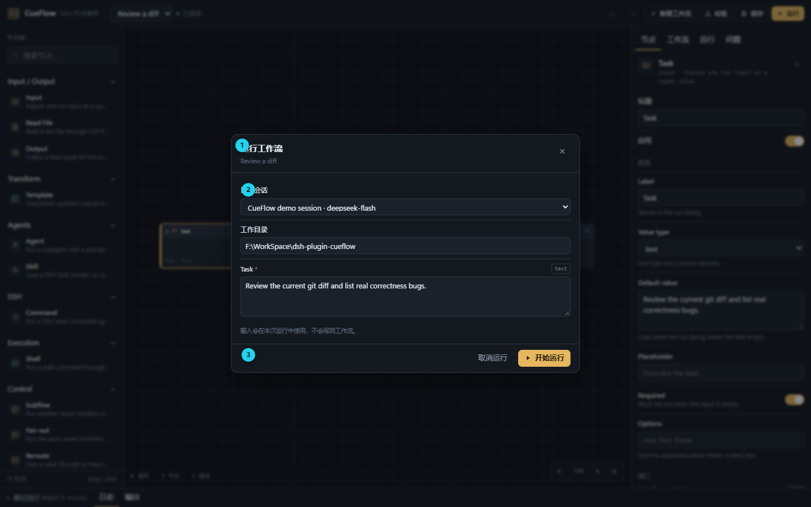
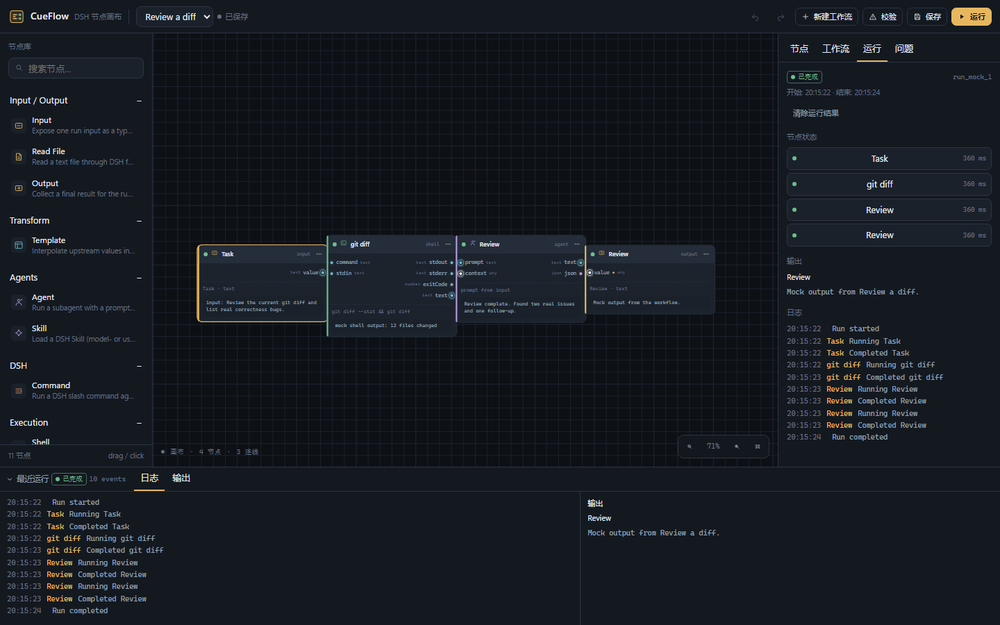
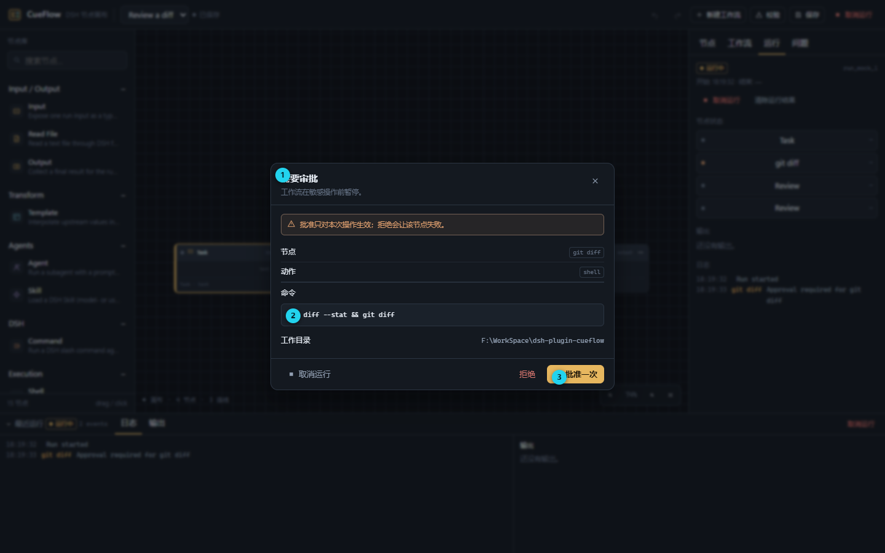

# CueFlow 用户手册

> 面向第一次打开 CueFlow 的人：先认识界面，再用 5 分钟搭出第一条流程，最后知道运行、审批、保存和排错在哪里。
>
> 节点完整参数见 [05 · 节点参考](docs/05-node-reference.md)；安装/发布见 [19 · npm 发布结构](docs/19-npm-release.md)。



## 1. 它是什么

CueFlow 是 DSH 里的“可视化工作流画布”。

你可以把它想成一条流水线：

```text
输入 → 处理节点 → 处理节点 → 输出
```

每个节点只做一件事，节点之间用线连接。点击“运行”后，CueFlow 按连线顺序执行，最后在底部输出结果。

常见用途：

- 把一段文字交给 Agent 总结/审查；
- 运行一个 DSH Skill；
- 执行 Shell 命令并把输出交给 Agent；
- 把一个工作流复用到另一个工作流（Subflow）；
- 对数组逐项执行（Fan-out）。

## 2. 安装与打开

### 从 DSH 插件管理安装

在 DSH 的插件管理中搜索并安装：

```text
@hope_phenom/dsh-plugin-cueflow
```

安装后重启 DSH。左侧栏出现 **CueFlow** 图标，点击即可打开。

> 如果安装后 DSH 启动失败，先确认版本是 **0.1.1 或更高**。0.1.0 的浏览器 factory id 没有改成 scoped 包名，会报 `duplicate factory registration`。详见 [安装失败记录](docs/reviews/2026-10-28-plugin-manager-duplicate-client.md)。

### 从本地目录安装（开发用）

```powershell
cd F:\WorkSpace\dsh-plugin-cueflow
pnpm install
pnpm build
dsh plugin --profile desktop add "F:\WorkSpace\dsh-plugin-cueflow"
```

### 打开后的检查

- 顶部能看到 workflow 选择器；
- 左侧有节点库；
- 右侧有“节点 / 工作流 / 运行 / 问题”四个 tab；
- 如果显示 `Host API unavailable`，说明 Host 路由没有加载，先重启 DSH，不要继续搭图。

## 3. 界面地图

对照总览图上的数字：

| 数字 | 区域 | 用途 |
|---|---|---|
| 1 | 顶部命令栏 | 选择/新建 workflow、撤销/重做、校验、保存、运行/取消 |
| 2 | 左侧节点库 | 搜索节点；点击或拖拽到画布 |
| 3 | 中间画布 | 放节点、拖线；拖空白平移，滚轮缩放，双击空白搜索节点 |
| 4 | 右侧检查器 | 选中节点后改配置；也放 workflow 设置、运行历史、问题 |
| 5 | 底部 dock | 最近运行、事件日志、输出；可折叠 |

### 两个最常用的动作

- **添加节点**：左侧节点库点击，或双击画布空白处搜索；
- **连接节点**：从节点右侧的**输出端口**按住，拖到另一个节点左侧的**输入端口**。

### 右侧检查器的四个 tab

| tab | 里面有什么 |
|---|---|
| 节点 | 选中节点的字段、端口连接状态、最近一次运行状态/错误 |
| 工作流 | 名称、描述、并发数、默认 cwd、会话模式、取消策略、运行历史、版本历史、导入/导出 |
| 运行 | 当前/最近 run 的状态、每个节点耗时、输出、事件日志、取消/重跑 |
| 问题 | 校验问题：必填、类型、环、重复输入等 |

**建议顺序**：先在“节点”改字段 → 再看“问题”消除校验错误 → 最后到“运行”看结果。

## 4. 五分钟 Hello World

目标：`Input → Template → Output`，运行后得到 `hello!`。

### 第 1 步：新建空白工作流

点击顶部 **新建工作流**，选择 **Blank workflow**。



选择后画布是空的：



### 第 2 步：添加 Input

在画布空白处**双击**，弹出节点搜索：



输入 `Input`，点击第一个结果。节点会出现在双击的位置。

> 也可以从左侧节点库直接点击或拖入 Input。

### 第 3 步：添加 Template 和 Output

同样双击空白处：

1. 搜索 `Template` 并添加；
2. 搜索 `Output` 并添加。

把三个节点大致摆成：

```text
Input  →  Template  →  Output
```

### 第 4 步：连线

1. 从 Input 右侧的 `value` 端口拖到 Template 左侧的 `value`；
2. 从 Template 右侧的 `text` 拖到 Output 左侧的 `value`。

端口有类型：如果线拖不上去，通常是类型不兼容，或者这个输入已经有连线。

### 第 5 步：配置

点击 Input，在右侧检查器设置：

- **Default value**：`hello`

点击 Template，设置：

- **Template**：`{{input}}!`

点击 Output，确认：

- **Name**：例如 `结果`
- **Format**：`text`

选中节点后，检查器会显示该节点的字段、端口连接状态和最近一次运行状态。

### 第 6 步：保存

点击顶部 **保存**。顶部 workflow 名称旁会从“未保存”变成“已保存”。

### 第 7 步：运行

点击顶部 **运行**，弹出运行对话框：



- **会话**：Agent/Skill/Command 需要一个 live DSH 会话；
- **工作目录**：Shell、Read File 等节点默认在这里执行；
- **Task/输入**：Input 节点的值；空白且 required 时会阻止运行。

点击 **开始运行**。

### 第 8 步：看输出

运行完成后，底部 dock 的 **输出** tab 应显示：

```text
hello!
```



右上检查器的 **运行** tab 还能看到：

- 整次运行状态；
- 每个节点的状态和耗时；
- 输出；
- 事件日志。

## 5. 端口、类型和连线规则

- 节点左侧是输入，右侧是输出；
- 线只能从输出拖到输入，不能反向；
- 端口颜色代表类型，例如 text / json / number / boolean / any；
- 一个输入通常只能接一条线；需要合并时用 **Merge**；
- 必填输入没连线或没值时，运行前/校验时会阻止；
- 删除线：点击线选中，按 `Delete`；
- 删除节点：选中后按 `Delete`，关联线会一起删除。

## 6. 常用节点

| 节点 | 什么时候用 | 关键配置 |
|---|---|---|
| Input | 把一次运行的参数暴露出来 | Label、Value type、Default value、Required |
| Template | 拼接文本、引用上游输出 | `{{input}}`、`{{nodeId.portId}}` |
| Agent | 让子 Agent 执行一段任务 | Prompt、Instructions、Provider/Model、超时、重试 |
| Skill | 运行 DSH Skill | Skill 名称、Instructions |
| Command | 运行 DSH slash command | Command、Approval |
| Shell | 执行命令 | Command、Working directory、Approval |
| Read File | 读取文本文件 | Path、Max characters |
| Condition | 按条件分到 true/false | Operator、Compare |
| Merge | 把多个分支合成一个值 | Mode、Separator |
| Subflow | 复用另一个已保存 workflow | Workflow ID、输入/输出映射 |
| Fan-out | 对数组逐项运行子 workflow | items、maxItems、concurrency |
| Output | 收集最终结果 | Name、Format、Preview lines |
| Note | 画布注释，不执行 | Text、Color |
| Group | 视觉分组框，不执行 | Label、Width、Height |
| Reroute | 整理连线，原样传递 | 无配置 |

完整字段与端口定义见 [05 · 节点参考](docs/05-node-reference.md)。

## 7. 运行状态与审批

### 状态

| 状态 | 含义 |
|---|---|
| idle | 还没运行，或已清空结果 |
| queued | 在全局队列里等待 |
| running | 正在执行 |
| waiting-approval | Shell/Command 需要你批准 |
| completed | 成功完成 |
| error | 有节点失败 |
| cancelled | 被取消 |
| skipped | 节点被跳过（onError=skip 或 disabled） |

### 审批

Shell、Command 节点默认 `approval=ask`。运行到该节点时会暂停并弹出：



- **批准一次**：只允许这一次执行；
- **拒绝**：该节点失败，按 onError 决定整条 run 是否停止；
- **取消运行**：中止整次 run。

审批详情里会显示节点、动作、命令、工作目录。**不要在不理解的命令上点批准。**

## 8. 保存、版本、工作区

- **保存**：顶部“保存”或 `Ctrl/Cmd+S`；
- **未保存标记**：workflow 名称后的黄点/“未保存”；
- **版本历史**：检查器 → **工作流** tab → **版本历史** → 列出/恢复；
- **运行历史**：检查器 → **运行** tab，或底部“最近运行”；
- **草稿恢复**：编辑后刷新/重开面板，若没有 active run，会恢复未保存草稿；
- **工作区**：workflow 保存时记录当前 cwd；列表按 workspace 过滤，避免多项目串稿。

> 版本保存在 `.history/<workflow id>/`，最多保留最近 20 版。

## 9. 快捷键

| 操作 | 快捷键 |
|---|---|
| 保存 | `Ctrl/Cmd + S` |
| 运行 | `Ctrl/Cmd + Enter` |
| 撤销 / 重做 | `Ctrl/Cmd + Z` / `Ctrl/Cmd + Shift + Z`（或 `Ctrl+Y`） |
| 复制 / 粘贴选中节点 | `Ctrl/Cmd + C` / `Ctrl/Cmd + V` |
| 删除选中节点/线 | `Delete` / `Backspace` |
| 关闭弹窗/菜单 | `Escape` |
| 缩放 / 适配 | 画布右下角 `- / % / + / Fit` |

## 10. 多选、分组和对齐

- **多选**：Shift/Ctrl + 点击节点；
- **框选**：Shift + 拖拽画布空白；
- **复制多个**：选中后 `Ctrl/Cmd+C`，再 `Ctrl/Cmd+V`；
- **对齐**：多选后画布顶部出现对齐工具条；
- **分组**：多选后点“分组”，会生成 Group 框；拖动 Group 会同步移动成员；
- **Reroute**：用直通节点整理长连线。

## 11. 场景演练

这一节不按“节点列表”讲，而是按真实任务讲：你要做什么、该放哪些节点、每个模块在哪里配置。

### 场景 1：审查当前 git diff

目标：先拿 diff，再让 Agent 审查，最后输出结论。

```text
Input(Task) ──value──▶ Agent(Review).prompt
Shell(git diff) ─text─▶ Agent(Review).context
Agent(Review) ─text──▶ Output
```

操作：

1. 新建 Blank workflow；
2. 添加 **Input**、**Shell**、**Agent**、**Output**；
3. Input 的 `Default value` 写：`Review the current git diff and report real correctness bugs.`；
4. Shell 的 `Command` 写：`git diff --stat && git diff`；
5. Shell 的 `Approval` 保持 `ask`；workflow 的 **默认工作目录** 填仓库路径；
6. Agent 的 `Instructions` 写：`Only report correctness bugs with file/line evidence. If none, say so.`；
7. 按上面的图连线：Input→Agent.prompt、Shell.text→Agent.context、Agent.text→Output.value；
8. 保存，运行；
9. 运行到 Shell 时会弹审批，确认命令和 cwd 后点 **批准一次**；
10. 底部 **输出** 看 Agent 的审查结果。

用到的模块：

- **节点库**：找 Input / Shell / Agent / Output；
- **画布**：拖线，把三个来源接到 Agent；
- **检查器 → 节点**：改 Shell 命令、Approval、Agent instructions；
- **检查器 → 工作流**：改默认 cwd；
- **运行对话框**：确认 Task 和 cwd；
- **审批弹窗**：只批准这一次命令；
- **底部 dock**：看日志和最终输出。

> Shell 的 `approval=ask` 是默认值。需要反复运行且完全信任这条命令时，才考虑 `allow`。

### 场景 2：运行一个 user-only Skill

目标：显式调用 `code-review` 这类只允许用户调用的 Skill。

```text
Input(Task) ─input──▶ Skill(code-review) ─text──▶ Output
```

操作：

1. 添加 Input、Skill、Output；
2. Skill 节点在检查器里搜索/选择 `code-review`；
3. Input 的默认值写你的审查任务；
4. 连线 Input.value→Skill.input、Skill.text→Output.value；
5. 运行对话框里必须选一个 **live 会话**；
6. 运行后看 Output 和运行日志。

检查器里的 Skill 字段现在是可搜索输入框：可以直接输入名字，也可以从下拉建议里选。user-only Skill 在 CueFlow 里也能选，因为 CueFlow 是 trusted caller。

### 场景 3：条件分支

目标：满足条件时走 Agent，不满足时走“无需处理”的输出。

```text
              ┌─ true ──▶ Agent(fix) ──▶ Output
Input ─▶ Condition
              └─ false ─▶ Output(no-op)
```

操作：

1. 添加 Input、Condition、Agent、Output；
2. Condition 的 `Operator` 选 `contains` 或 `regex`；
3. `Compare with` 填写要匹配的文本；
4. 把 Condition 的 `true` 接到 Agent，`false` 接到另一个 Output；
5. 两边 Output 都可以接，未走的分支会标记为 `skipped`，不是错误；
6. 需要把两个分支合回一个值时，用 **Merge**。

### 场景 4：复用与批量

**Subflow**：把另一个已保存的 workflow 当成一个节点运行。

- Subflow 的 `Workflow ID` 填已有 workflow 的 id；
- 子 workflow 的 Input 节点按 node id 接收输入；
- 嵌套深度上限 5；
- 子 workflow 里的 `approval: ask` 没有 UI 审批面，需要显式改成 `allow`，或在外层先处理审批。

**Fan-out**：一个数组逐项运行同一个子 workflow。

- `items` 接数组；
- `itemKey` 指向子 workflow 的 Input 节点 id；
- `maxItems` 控制上限（默认 20）；
- `concurrency` 控制并发（1–8）；
- `onItemError=skip` 会记录失败项并继续。

### 场景 5：选择会话模式

工作流检查器 → **工作流** tab → **会话模式**：

| 模式 | 行为 | 适合 |
|---|---|---|
| isolated | 每个 Agent/Skill 节点一个独立 child session | 默认；并行、可复现 |
| inherit | child 继承父会话快照（fork） | 需要当前任务上下文 |
| workflow | 一次 run 复用同一个 child session | 多步 Agent 保留上下文 |
| parent | 在当前父会话执行，结果写回对话 | 专用/空会话；会写入当前对话 |

**parent 是高风险模式**：它会把提示词写入当前会话。不要在日常主会话里随意使用；用专用会话测试。

Command 节点比较特殊：它在选中的父会话上执行，不像 Agent/Skill 那样新建 child。

### 场景 6：改错了怎么回滚

1. 打开检查器 → **工作流** tab；
2. 点 **版本历史**，选择要恢复的版本；
3. 恢复前当前版本也会先归档；
4. 如果只是想复用当前图，用 **导出** 保存 JSON；下次 **导入**；
5. 如果只是浏览器刷新丢了未保存修改，重开面板时通常会自动恢复草稿；但**保存过**的版本以版本历史为准。

### 场景 7：运行失败怎么定位

1. 先看底部 dock 的 **日志** tab，找红色错误；
2. 检查器 → **运行** tab，看哪个节点是 `error`；
3. 检查器 → **问题** tab，看校验问题（必填、类型、环、重复输入）；
4. 如果是 Shell/Command：检查审批是否被拒绝、cwd 是否正确、命令是否真的存在；
5. 如果是 Agent/Skill/Command：确认运行对话框里选了 live 会话；
6. 如果是插件安装/启动失败：看 DSH 的 `crash-*-web-boot.log`。

## 12. 常见问题

### 面板显示 Host API unavailable

Host 插件没加载。检查：

1. 插件是否安装到了当前 profile；
2. DSH 是否重启过；
3. 是否有旧版本同时安装；
4. 看 DSH 的 `crash-*-web-boot.log`。

### 运行提示需要 live session

Agent / Skill / Command 需要先打开一个 DSH 会话。打开会话后再点运行。

### 审批窗口没出现

- 确认节点 `approval=ask`；
- 检查 run 是否停在 `waiting-approval`；
- 审批是 one-shot，拒绝或超时后不会自动出现第二次。

### 插件安装后 DSH 启动失败

典型日志：

```text
duplicate factory registration for "dsh-plugin-cueflow"
```

使用 **0.1.1 或更高版本**；0.1.1 已把浏览器 factory id 改成 scoped 包名。卸载旧包后重装并重启。

### 运行失败但不知道哪个节点

打开底部 dock 的 **日志**，或检查器 **运行** tab 的节点状态；错误会带 nodeId/节点标题。

## 13. 安全边界

- Shell/Command 默认需要审批；
- `approval=allow` 会跳过审批，只应在可信工作流使用；
- CueFlow 的 API 是 CSRF 防护，不是用户认证；不要把 DSH Web 直接暴露到公网；
- 多用户/团队使用需要 DSH 自身的认证与权限。
