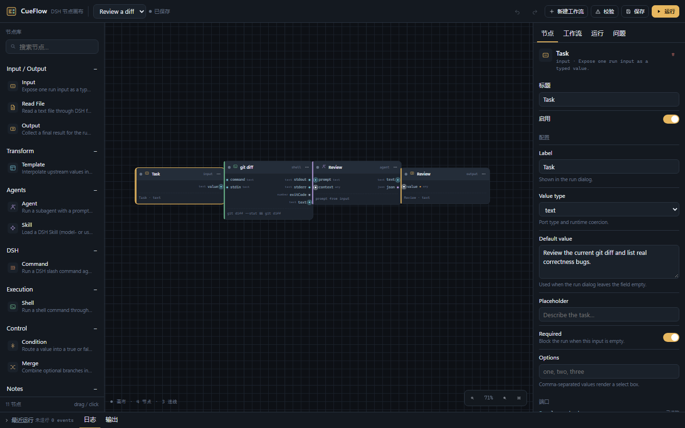
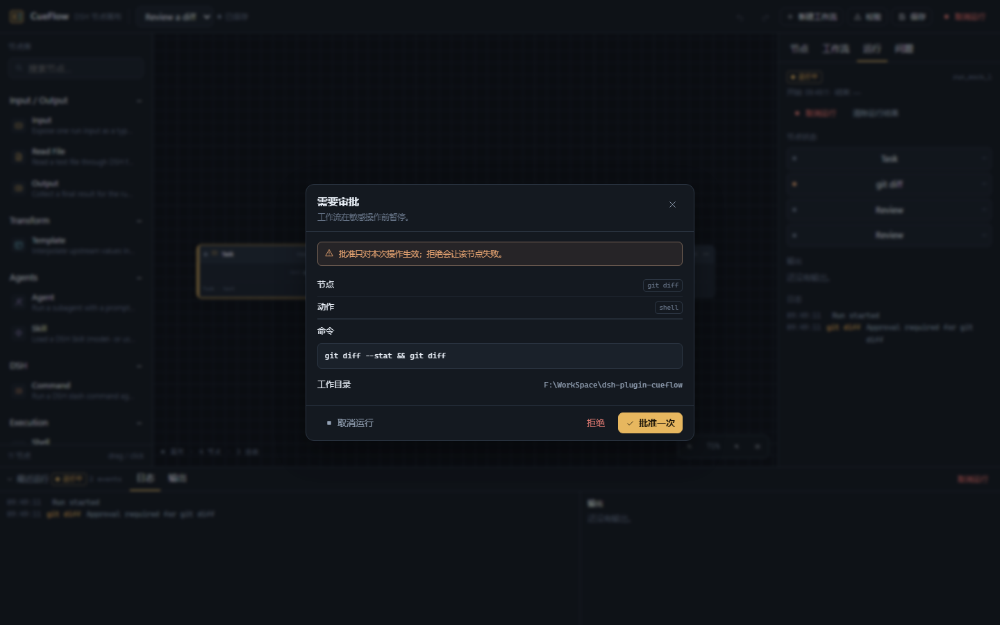

# 12 · 使用文档

> 面向第一次使用 CueFlow 的人：安装、打开、搭第一条流程、运行、排错。
> 设计原因见 [13 · 设计阐明](13-design-rationale.md)；能力缺口见 [14 · 工作负载差距](14-readiness-gaps.md)；API 见 [15 · API 参考](15-api-reference.md)。

## 1. 安装

前提：DSH 已安装，且你有一个可启动的 profile（桌面版通常是 `desktop`）。

### 从本地目录安装

```powershell
# 先退出 DSH 桌面应用：它会锁住 profile 目录
cd F:\WorkSpace\dsh-plugin-cueflow
pnpm install
pnpm build
dsh plugin --profile desktop add "F:\WorkSpace\dsh-plugin-cueflow"
```

启动 DSH，左侧栏出现 **CueFlow** 图标。首次安装或替换同包通常需要重启 DSH。

### 从插件市场 / npm 安装

当前仓库仍以本地目录开发为主；发布 npm 包后，可在 DSH 的 **插件** 页搜索 `dsh-plugin-cueflow` 安装。安装后仍需重启 DSH 让 Host 行生效。

### 验证安装

打开一个会话，再打开 CueFlow：

- 面板顶部出现 workflow 选择器；
- 右侧检查器显示 `节点 / 工作流 / 运行 / 问题`；
- 如果显示 `Host API unavailable`，说明 Host 路由没挂上，先检查 DSH 是否以 Web/桌面模式加载了 plugin。

## 2. 第一次使用：Hello World

目标：Input → Template → Output，得到 `hello!`。

1. 左侧栏点击 **CueFlow**。
2. 点击 **新建工作流** → **Blank workflow**。
3. 从左侧节点库拖入 **Input**，双击画布空白处搜索并添加 **Template**、**Output**。
4. 从 Input 的 `value` 端口拖线到 Template 的 `value`；从 Template 的 `text` 拖到 Output 的 `value`。
5. 选中 Input，在右侧把 **Default value** 改成 `hello`。
6. 选中 Template，把 **Template** 改成 `{{input}}!`。
7. 点击 **保存**。
8. 点击 **运行**，在对话框里确认 Task 是 `hello`，点击 **开始运行**。
9. 底部 dock 的 **输出** 应显示 `hello!`。



## 3. 界面速览

| 区域 | 作用 |
|---|---|
| 顶部命令栏 | workflow 选择、保存、校验、运行/取消、撤销/重做、新建 |
| 左侧节点库 | 按类别搜索/拖拽节点；点击也会在视口中央添加 |
| 画布 | 平移（拖空白/中键）、缩放（滚轮）、双击搜索、右键菜单 |
| 节点 | 左侧色脊=分类，cue light=状态，左右为输入/输出端口 |
| 右侧检查器 | 节点配置、workflow 设置、run 状态、问题列表 |
| 底部 dock | 运行日志、输出、取消按钮 |

### 快捷键

| 操作 | 快捷键 |
|---|---|
| 保存 | `Ctrl/Cmd + S` |
| 运行 | `Ctrl/Cmd + Enter` |
| 撤销 / 重做 | `Ctrl/Cmd + Z` / `Ctrl/Cmd + Shift + Z` 或 `Ctrl+Y` |
| 删除选中节点/连线 | `Delete` / `Backspace` |
| 关闭对话框/菜单 | `Escape` |
| 缩放/适配画布 | 右下角 `- / % / + / Fit` |

## 4. 节点速查

完整规格见 [05 · 节点参考](05-node-reference.md)。

### Input
把一次运行的输入暴露给图。`required` 打开时，空值会在运行前被拦下。

### Template
```text
Review this diff:

{{input}}
```
支持 `{{input}}`、`{{nodeId.port}}`、`{{vars.key}}`；未知占位符会保留。

### Agent
让子代理执行提示词。`prompt` 端口优先于配置里的 Prompt；`context` 会作为 `<context>` 附加。
- `outputSchema` 可要求结构化输出；
- `parseJson` 可尝试把文本解析成 JSON；
- `timeoutMs` 默认 10 分钟。

### Skill
选择一个 DSH Skill 并执行。**user-only skill 也可以选**，因为 CueFlow 是 trusted caller。
- Skill 不存在时，错误会列出最接近的名字；
- 运行日志记录 `modelInvocable/userInvocable`，便于审计。

### Command
执行 DSH 斜杠命令（不带 `/`），例如 `remote-use` + 输入 `status`。
- 必须有 live 会话；
- 优先 `ctx.commands.execute`，保留命令生命周期；
- 命令结果作为文本输出。

### Shell
通过 `ctx.shell` 执行命令，受 DSH sandbox / permission 配置约束。
- 建议把 workflow 的 cwd 设成项目目录，而不是用户 home；
- `workspace-write` 下 `%TEMP%` 必须位于 workspace 之外，否则 Windows ACL 会拒绝；
- 非零退出默认失败，可关闭 `failOnNonZero`。

### Read File
只读文件，路径相对 run cwd 或绝对路径；内容超过 `maxChars` 会截断。

### Condition / Merge
Condition 把值路由到 `true`/`false`；未走分支无值，下游必填输入会 `skipped`。Merge 用 `first`/`array`/`concat` 汇合分支。

### Output
收集最终结果，显示在运行面板与 `run.outputs`。

### Note
纯画布批注，不执行。

## 5. 常用示例

### 示例 A：审查当前 diff

```text
Input(Task) ──prompt──▶ Agent(Review)
Shell(git diff) ─context──▶ Agent(Review) ─text──▶ Output
```

Shell 配置：
```text
git diff --stat && git diff
```
workflow cwd 设成仓库目录；Agent 的 instructions 写“只报告真实 correctness 问题，附文件/行证据”。

### 示例 B：运行一个 user-only Skill

```text
Input(Task) ─input──▶ Skill(code-review) ─text──▶ Output
```
Skill 节点选择 `code-review`，Task 填“Review the current change.”。这等价于用户显式调用该 Skill。

### 示例 C：执行状态命令

```text
Command(remote-use, input=status) ─text──▶ Output
```
需要先打开一个 live 会话；结果会在输出面板显示。

### 示例 D：条件分支

```text
Input ─value──▶ Condition ─true──▶ Agent(fix)
                         └false──▶ Output(no-op)
```
未走的分支会 `skipped`，不是失败。

## 6. 运行对话框

- **目标会话**：Agent/Skill/Command 的父级 live Agent。CueFlow 是 root-scope 面板，不隐式猜当前会话；默认选最近注册的 live 会话。
- **工作目录**：Shell/File 及子代理的 cwd；建议填项目目录。
- **Input 字段**：只作用于本次 run，不写回 workflow；必填为空时 Start 被禁用，Host 也会二次校验。

### 会话模式

工作流设置里可选：

- **隔离（默认）**：每个 Agent/Skill 节点一个 child session，适合并行与可复现；
- **继承父会话快照（fork）**：child 仍独立，但继承父会话上下文；适合需要当前任务背景的节点。

`workflow`（一次 run 复用 child）和 `parent`（写回当前对话）当前**未开放**，因为 DSH 还没有提供“等待已有 child turn 结果/向父会话发 turn”的宿主 API；不会用假实现冒充。

工作流设置还有 **取消策略**：`abort-all`（立即中止）或 `drain`（停止启动新节点，等待当前节点完成）。

### 运行会在“同一个会话”里吗？

**不是所有节点都在同一个 DSH 会话里。** 准确地说：

| 节点 | 运行位置 |
|---|---|
| Agent / Skill | 在选中的父会话下启动**子代理**；`spawn` 创建新 child session，`fork` 也仍是 child session；`delivery:'caller'` 只把结果返回 CueFlow，不写入父会话消息 |
| Command | 在选中的 **父会话** 上执行 `ctx.commands.execute(parent, …)`，命令生命周期记在父会话 |
| Shell / Read File | 在 Host 进程内执行，使用 run cwd 与 DSH 的 shell/fs 策略；不进入会话消息 |
| 图/调度/日志 | CueFlow Host 的 `RunManager`，独立于 DSH 会话日志 |

所以：**图是一次 CueFlow run，不是一次 DSH 对话 turn；Agent/Skill 节点各自有 child session，Command 才落在父会话。** 详见 [13 · 设计阐明](13-design-rationale.md#5-会话模型为什么不是同一个会话) 与 [D-009/D-045](decisions.md)。

## 7. 保存、导入、导出

- **保存**：写入 `$DSH_HOME/storages/dsh-plugin-cueflow/workflows/<id>.json`。
- **导出 JSON**：工作流检查器 → 工作流 → 导出；文件可分享/版本化。
- **导入 JSON**：同一区域导入；导入前会做 normalize + validate。
- **运行记录**：`runs/<id>.json`，默认保留最近 50 条；run 内含 workflow 快照，workflow 后续编辑不影响历史 run 的复现。
- **历史版本**：每次保存前把旧版归档到 `workflows/.history/<id>/`，保留最近 20 版；工作流面板 → 版本历史可恢复。恢复前会先归档当前版本。

## 8. 排错

| 现象 | 处理 |
|---|---|
| 面板空白 / Host API unavailable | 检查 DSH 是否重启、plugin 是否在 profile bundles；看 Host 日志 |
| 面板显示但没有 live session | 先打开一个 DSH 会话，再运行 Agent/Skill/Command |
| Skill 找不到 | 在 Skill 下拉里确认名字；user-only skill 也可用 |
| Command 找不到 | 在 catalog 下拉确认命令；需要 live session |
| Shell `SANDBOX_UNAVAILABLE` | workflow cwd 设成项目目录，确保 `%TEMP%` 不在 workspace 内；或切换 DSH 的 sandbox 配置 |
| Shell 退出码 3221225794 | 常见于 Windows sandbox runner 未配置 shim；桌面 profile 应使用 `C:\dsh-sandbox-mediator\shim.mjs` |
| 运行前校验 422 | 打开 **问题** tab，按节点定位；Input 必填值、类型、环都会被拦 |
| 保存后刷新丢失 | 确认点了 **保存**（dirty 指示器）；当前版本没有自动保存 |
| 页面刷新后看不到正在跑的 run | 当前版本需要已知 run id；active-run 重连在差距清单 P0 |

## 9. 安全提示

- Shell 节点会执行命令；不要把不可信模型输出直接接到 Shell。
- Command 节点会执行已注册命令；先确认命令语义。
- Shell/Command 默认 `approval: ask`：运行到该节点时 UI 会暂停并显示命令/动作，只有点击 **批准一次** 才执行；**拒绝** 会让该节点失败。
- 需要频繁运行的受控命令可显式改成 `allow`；不希望执行的节点用 `deny`。审批记录（approvalId、命令、cwd、决定）写入 run JSON。


- CueFlow 的审批是 Host 独立队列，不复用 DSH `ctx.approval`（run 不在 DSH turn 内）；DSH sandbox 仍然生效。公开部署还需 M6-P0-2 的 API 认证。
- Skill 的 user-only 语义是“用户显式调用”；CueFlow 会记录 invocation 到 run 日志。
- 没有任意 JS/Python 代码节点；可执行能力仅白名单节点。

## 10. 更多

- 节点字段： [05 · 节点参考](05-node-reference.md)
- 执行/重试/取消语义： [07 · 执行引擎](07-execution-engine.md)
- 从机实机记录： [2026-10-28 从机验证](reviews/2026-10-28-remote-verification.md)
